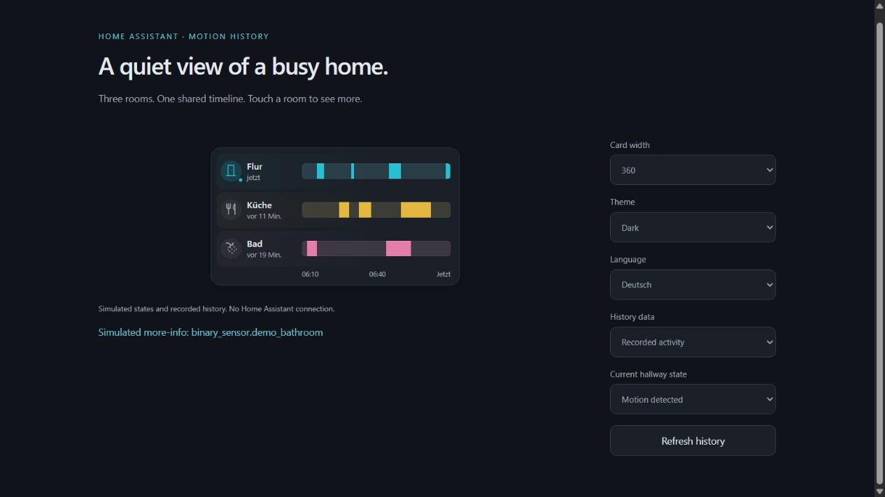

# Motion History Card

A compact Home Assistant card for room activity and aligned motion history. Replaces a composition of tile cards, history-graph, mod-card and layout-card with one locally bundled card.



## Features

- Room name, configurable icon and relative **last state change**, like a tile with `state_content: last_changed`. This is not the last time motion was detected.
- A shared one-hour timeline, refreshed every 30 seconds by default. Each history row is aligned with its room; names are not duplicated on the graph.
- Cyan, yellow and pink defaults; custom palette or hex colors per sensor.
- Tap either a room or its timeline for Home Assistant's native more-info dialog. Keyboard Enter and Space work too.
- Compact 52 px rows, a 14 px frame and a 1:2 label/history layout, adjusted for narrow cards. Long names can expand a row instead of clipping.
- Visual editor for adding, removing and reordering sensors, labels, icons, colors and timing.
- English/German labels, HA locale/time zone, light/dark themes, reduced motion and visibility-aware polling.
- No additional dashboard plugins, external fonts or CDN scripts.

## Install with HACS

[](https://my.home-assistant.io/redirect/hacs_repository/?owner=jancrab&repository=homeassistant-motion-history-card&category=plugin)

Add `https://github.com/jancrab/homeassistant-motion-history-card` as a **custom repository**, category **Dashboard**, download the card, then reload the browser. This is custom-repository distribution, not a claim of inclusion in the default HACS catalog.

Check the module resource: `/hacsfiles/homeassistant-motion-history-card/homeassistant-motion-history-card.js`.

## Configuration

```yaml
type: custom:homeassistant-motion-history-card
hours_to_show: 1
refresh_interval: 30
entities:
  - entity: binary_sensor.hall_motion
    name: Hall
    icon: mdi:door
    color: cyan
  - entity: binary_sensor.kitchen_motion
    name: Kitchen
    icon: mdi:silverware-fork-knife
    color: yellow
  - entity: binary_sensor.bathroom_motion
    name: Bathroom
    icon: mdi:shower
    color: pink
```

Replace the example entity IDs with your own. Any 1–12 binary sensors can be selected, with `on` representing activity. String entity IDs are also accepted in the entities list. Names and icons fall back to the entity's attributes.

| Setting | Default | Values |
| --- | --- | --- |
| `entities` | Required | 1–12 unique binary sensor IDs or objects |
| `hours_to_show` | `1` | 1–24 hours |
| `refresh_interval` | `30` | 10–3600 seconds |
| Per-row `name` | Entity name | Optional text |
| Per-row `icon` | Entity icon / `mdi:motion-sensor` | Optional HA icon |
| Per-row `color` | cyan / yellow / pink | cyan, yellow, pink, blue, green, purple, orange or `#RRGGBB` / `#RGB` |

## Reading the history

Solid colored blocks mean `on`, subdued blocks mean `off`. Hatched sections mean unknown, unavailable or missing data. Hover a section for its state and time range; tap the row for native details. The active room also gains a small pulsing status dot; reduced motion disables the pulse.

The card reads **recorded history**, not an inferred reconstruction from the current state. Home Assistant's `history` and `recorder` integrations must be enabled and recording the selected entities. Empty/excluded history is shown as **No history**. Request failures show an explicit retry option. If an update fails, the last successful window retains its actual end timestamp rather than stretching to now.

The current sensor state updates independently of the history refresh. Polling and animation pause when the card is offscreen or the page is hidden; a visible card refreshes on return. No token needs to be configured: the card uses the current HA session.

## Manual installation

Download `homeassistant-motion-history-card.js` from the [release](https://github.com/jancrab/homeassistant-motion-history-card/releases/latest), copy it to `/config/www/`, and register `/local/homeassistant-motion-history-card.js?v=0.1.0` as a **JavaScript module** under Settings → Dashboards → Resources. Reload the browser. On updates replace the file and change the version query on the existing resource.

## Development and validation

```sh
npm ci
npm run check
npm run dev
```

The preview at `http://127.0.0.1:4173` uses simulated states, history and native components. See [validation](docs/validation.md) for the actual checks and limits. Neither tests nor screenshots constitute live Home Assistant verification.

See [AGENTS.md](AGENTS.md), [working guide](docs/working-guide.md), [design guide](docs/design-style.md) and [adaptation prompt](docs/design-adaptation-prompt.md). UI code is independently implemented from the user's dashboard composition, with atmospheric minimalism as visual inspiration; no Origami Weather source or assets are included in the runtime. MIT; see [LICENSE](LICENSE).

API references: [HA custom cards](https://developers.home-assistant.io/docs/frontend/custom-ui/custom-card/), [HA recorded history endpoint](https://developers.home-assistant.io/docs/api/rest/), [HACS dashboard requirements](https://hacs.dev/docs/publish/plugin/).
